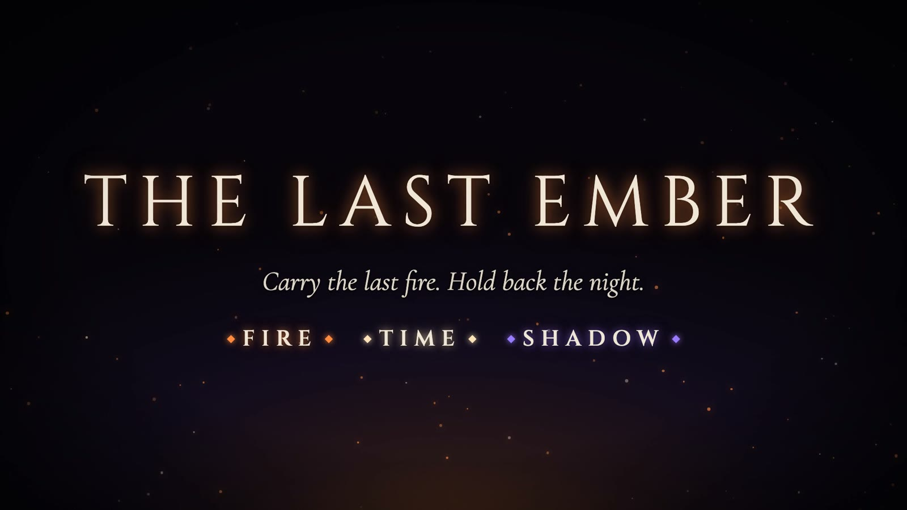
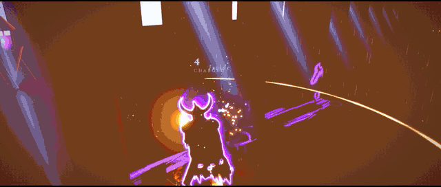
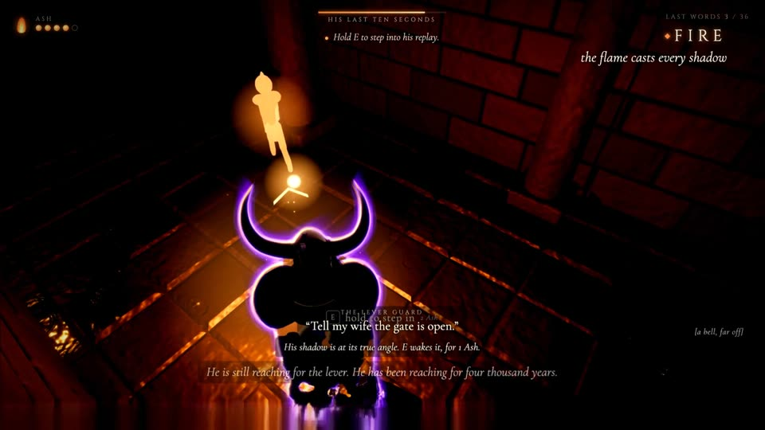
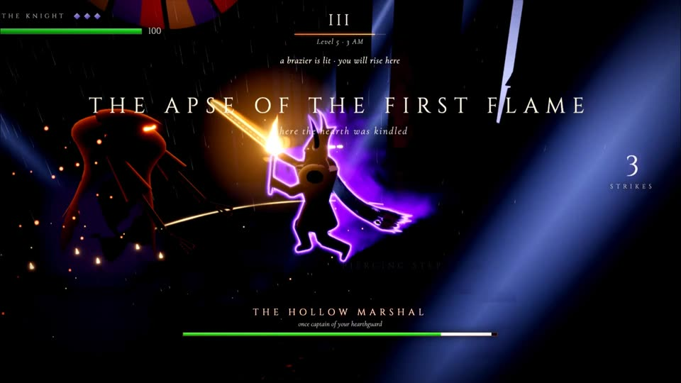

  

  <b>A city frozen one second before the flood. One flame. One night.</b> 
  <i>Carry the last fire. Hold back the night.</i>

  
  
  

  

---

## How Fire, Shadow & Time fuse

> **Fire makes the shadows. Shadows hold the past. And where you hold the flame decides what happens next.**

| | In play | In the story | In the atmosphere |
|---|---|---|---|
| 🔥 **Fire** | The flame in your hand is aimed with the camera, and it casts every shadow in the city | The last fire in the world, and the hearth you must keep alive | The only warm colour in a city of rain and stone |
| 🌑 **Shadow** | Lit shadows turn solid (walk your own shadow across a canal); shades rise from the shadows the fire throws | The Wrong Shadow, which moves only when you look away | Every frozen person is a shadow waiting to be seen |
| ⏳ **Time** | Light a frozen figure from its true angle and its last ten seconds replay. Spend Ash to step in, or rewind | Time stopped one second before the flood. At the hearth it runs out, hour by hour | A frozen city, then a night from 7 PM to dawn |

## Two acts, one night

<table>
<tr>
<td width="50%"></td>
<td width="50%"></td>
</tr>
<tr>
<td valign="top">

**Act I · The Still City**: a third-person puzzle adventure through five districts: the Gate Ward, the Market of Weights, the Temple of Hours, the Library of Whispers and the Heart. Wake the frozen and step into their last moments. And watch for the shadow that moves when you look away.

</td>
<td valign="top">

**Act II · The Hearth**: third-person action from sunset to dawn. Shades crawl out of the fire's shadows. At midnight the hearth dies and you carry its last flame as a torch. The Hollow Marshal waits at 3 AM, and a choice waits at dawn.

</td>
</tr>
</table>

Easy, Medium and Hard apply to both acts. The title screen's **Chapters** list jumps to any district or any hour.

## Controls

| Action | Act I · The Still City | Act II · The Hearth |
|---|---|---|
| Move | `W A S D` | `W A S D` |
| Look | Mouse (the flame follows: look up to lift it) | Mouse |
| Act | `E` / click: wake a shadow, rest, read | Click / `J`: strike |
| Special | Hold `E`: step into a replay · Hold `R`: rewind | Right click / `K`: heavy cleave (hold to charge) |
| Shift | Draw the flame back (your shadow runs ahead) | Shadow-step |
| More | Right click / `Q`: Flame Lock · `H`: ask for a hint | `Space`: jump, double jump · hold `R`: restart the level |
| Pause | `Esc` | `Esc` |

## Play it

| | |
|---|---|
| 🌐 **In the browser** | **https://the-last-ember-xi.vercel.app** |
| 💻 **Locally** (Node 20.19+) | `python run.py` installs, serves on http://localhost:5174 and opens it (or `npm i && npm run dev`) |
| 🤖 **Watch the bot play it** | `python demo.py --restart`, then `python demo.py` to resume |

<b>The live demo, in detail</b>

`python demo.py` opens a Chrome window on the local dev server (it starts `python run.py` if needed; no internet
required), and the bot plays both acts.
- **Stopping is always safe** (Ctrl+C, closing the terminal). The game pauses where it stands and the window stays open;
  anyone can resume from the menu and play.
- **Running it again** puts the bot back at exactly where it was, whatever was done in between.
- `--restart` starts from the beginning, and `--live` plays the deployed site.
- A stuck bot restarts its district, or skips ahead, by itself. Details: [`scripts/demo.mjs`](scripts/demo.mjs).

## The team

- **Mohammed Zain ul Hassan**
- **Ahnaf Abdullah**
- **Moeez Abid**: game design and narration of the Still City
- **Huzaifa Tahir**

Built in 3 days for a vibe-coding game jam, with Claude Code · Three.js, TypeScript and Vite.

## Credits & assets

- **Art, models, effects, sound and music** are made in code by the team (procedural geometry, shaders, WebAudio), and the trailer's score is synthesised in numpy. There are no third-party samples.
- **Fonts:** Cinzel and Cormorant Garamond (SIL Open Font License).
- Every source and licence is listed in [`ASSETS.md`](ASSETS.md).
- **Trailer pipeline:** [`trailer/`](trailer/). The game records itself; the cut is planned against the jam's rules and edited in Remotion. Plan and research: [`docs/trailer-v2.md`](docs/trailer-v2.md).
